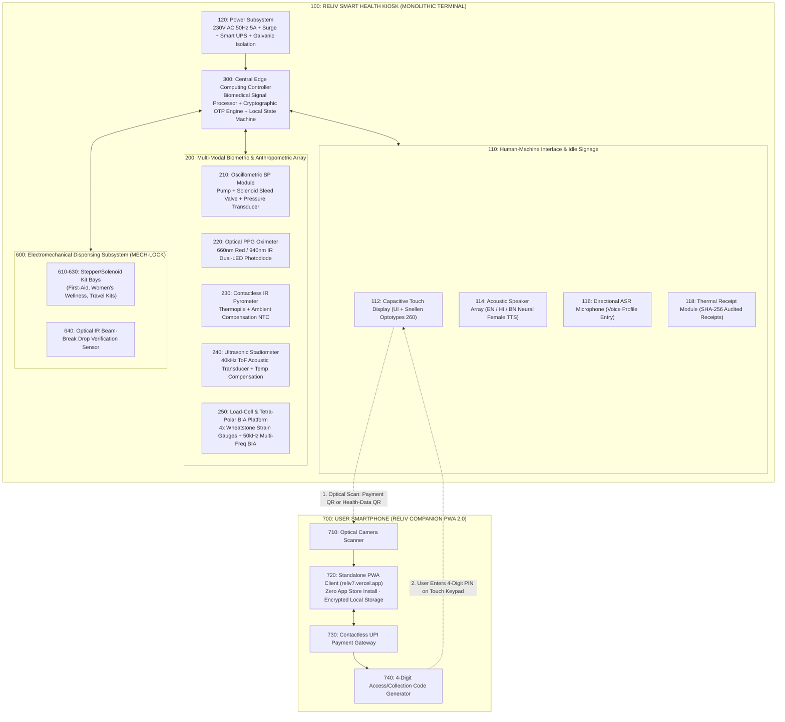
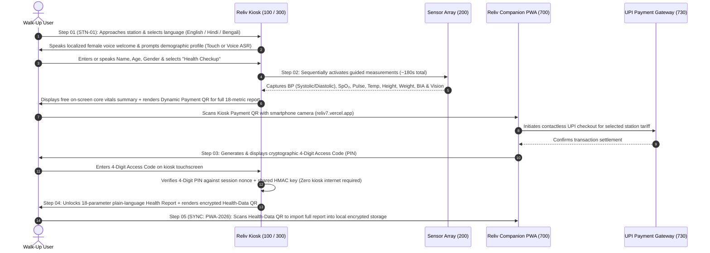
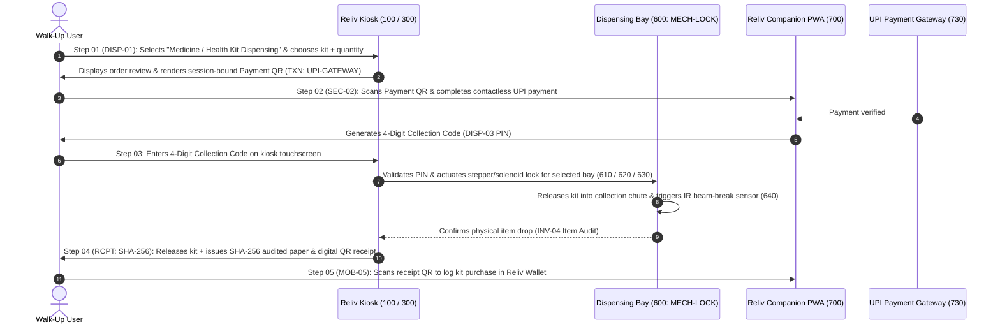
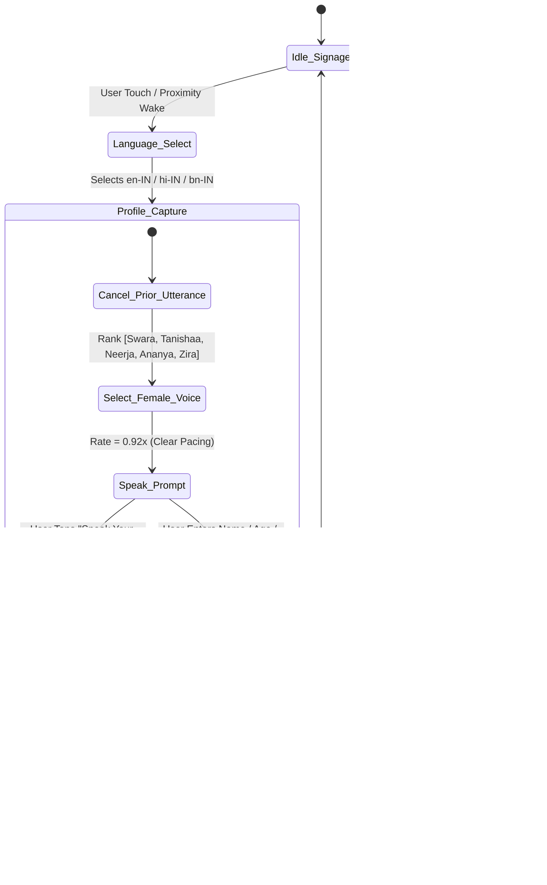

# COMPLETE SPECIFICATION (FORM 2)
## THE PATENTS ACT, 1970 (39 of 1970) & THE PATENTS RULES, 2003
### *(See Section 10 and Rule 13)*

---

## BIBLIOGRAPHIC DATA (WIPO ST.9 / INID CODES)

| INID Code | Field | Specification Details |
| :--- | :--- | :--- |
| **(12)** | **Document Type** | Complete Patent Specification (2025 Technical Disclosure) |
| **(54)** | **Title of the Invention** | **AN AUTONOMOUS MULTI-MODAL PREVENTIVE HEALTH SCREENING, BIO-IMPEDANCE ANALYTICS, AND CRYPTOGRAPHICALLY ACTUATED HEALTH-ESSENTIALS DISPENSING KIOSK SYSTEM AND METHOD THEREOF (RELIV KIOSK — 2025)** |
| **(71)** | **Applicant / Assignee** | **RELIV MEDICARE PRIVATE LIMITED**<br>A company incorporated under the Companies Act, 2013 (Incorporated: 16 February 2026; CIN: `U86909WB2026PTC287414`)<br>DPIIT Startup India Recognition No.: `DIPP287544`<br>Registered Address: Kolkata, West Bengal, India<br>*(Assignee via Pre-Incorporation Inventor Assignment of Confidential 2023–2025 R&D)* |
| **(72)** | **Inventors** | 1. **Faizan Khan** (Indian National — Founder & Chief Executive Officer)<br>2. **Jiya Bhati** (Indian National — Co-Founder & Chief Technology Officer)<br>3. **Vaibhav Pasari** (Indian National — Chief Financial Officer) |
| **(22)** | **Conception, R&D & Disclosure Timeline** | **Conception & Confidential Internal Lab R&D Initiated:** **2023**<br>**Complete Technical Architecture Specification:** **2025** (`Reliv Smart Health Kiosk / Health ATM Platform — 2025 Architecture`)<br>**Corporate Applicant Incorporation & IP Assignment:** **2026** |
| **(51)** | **International Patent Classification (IPC)** | `A61B 5/00` (Measuring for diagnostic purposes); `A61B 5/021` (Measuring pressure in heart or blood vessels); `A61B 5/1455` (Optical pulse oximetry); `A61B 5/053` (Measuring electrical impedance of the body); `A61B 3/028` (Subjective testing of visual acuity); `G16H 40/63` (ICT specially adapted for management or operation of medical equipment at local level); `G07F 11/00` (Coin-freed or code-actuated apparatus for dispensing discrete articles); `G06Q 20/32` (Payment architectures using wireless/QR protocols) |
| **(52)** | **Cooperative Patent Classification (CPC)** | `A61B 5/7475`, `A61B 5/0022`, `A61B 5/6898`, `G16H 10/60`, `G16H 50/30`, `G07F 17/0092`, `G07F 9/02`, `G06F 21/606` |

---

> **PREAMBLE TO THE DESCRIPTION:**  
> *The following specification particularly describes the invention and the manner in which it is to be performed.*

---

## 1. FIELD OF THE INVENTION

**[0001]** The present invention relates generally to autonomous medical-grade and preventive wellness screening terminals, biomedical instrumentation, and automated vending/dispensing systems.

**[0002]** More particularly, the present invention relates to an integrated, walk-up **Smart Health Kiosk (also referred to as a "Health ATM")** engineered by **Reliv Medicare Private Limited** (`Reliv Kiosk — 2025 Architecture`) that combines:
1. A non-invasive multi-sensor physiological and anthropometric acquisition array capable of capturing and deriving up to eighteen (18) vital and body-composition parameters within an approximately three-minute (`~180-second`) self-guided session;
2. A deterministic multilingual neural voice-guidance and speech-recognition state machine operating in English (`en-IN`), Hindi (`hi-IN`), and Bengali (`bn-IN`);
3. A cryptographically verifiable, air-gap-tolerant **Quick Response (QR)-to-Four-Digit One-Time Access Code (`PIN/OTP`)** payment and actuation bridge that eliminates persistent cellular/broadband dependency on the physical terminal;
4. An electromechanical multi-bay health-essentials dispensing subsystem for automated 24×7 release of emergency first-aid kits, women's wellness supplies, and preventive health kits with SHA-256 audited receipt generation; and
5. A zero-app-store-latency Progressive Web Application (`PWA 2.0`) companion ecosystem configured for optical Health-Data QR ingestion and encrypted local longitudinal biometric storage on a user's personal mobile device.

---

## 2. BACKGROUND OF THE INVENTION & PRIOR ART LIMITATIONS

**[0003]** Epidemiological studies across developing and developed nations consistently demonstrate that over **70% of fatal and debilitating health events**—including hypertensive crises, cardiovascular disease, stroke, and metabolic syndromes—stem from undetected, asymptomatic lifestyle risk markers. Routine early screening of fundamental physiological indicators such as systolic and diastolic blood pressure, arterial oxygen saturation ($\text{SpO}_2$), resting pulse rate, core/surface temperature, body mass index ($\text{BMI}$), body fat distribution, and visual acuity can identify these anomalies years before acute clinical presentation.

**[0004]** Despite the clinical value of preventive screening, large segments of the population—particularly university students, corporate employees, fitness center members, and daily commuters—rarely undergo routine checkups. Existing solutions in the prior art suffer from five fundamental technical and operational deficiencies:

### 2.1 High Friction and Staffing Overhead of Conventional Diagnostic Booths
**[0005]** Traditional clinic outpatient departments (OPDs) and manned health camps require trained phlebotomists, nurses, or paramedical operators. Staffing costs make continuous 24×7 operation economically unviable in colleges, offices, gyms, or transit lobbies. Furthermore, appointment scheduling and waiting-room bottlenecks deter asymptomatic individuals from completing a 3-minute preventive check.

### 2.2 Sensor Fragmentation and Lack of Ergonomic Sequential Guidance
**[0006]** Consumer-grade home devices (such as standalone blood pressure cuffs, fingertip oximeters, or bathroom scales) are fragmented across separate hardware units, lack standardized posture enforcement, and suffer from high user-induced measurement error when operated without real-time audio-visual guidance. Prior-art multi-parameter kiosks typically require a human attendant to position the user, select parameters, and interpret raw numerical outputs.

### 2.3 Linguistic and Health-Literacy Barriers
**[0007]** Existing self-service kiosks rely heavily on dense text menus in a single language (typically English) and output raw clinical tables without plain-language contextualization. First-time users, regional-language speakers, and seniors frequently abandon sessions mid-flow or misplace their arms/fingers during oscillometric cuff inflation or optical photoplethysmography ($\text{PPG}$) acquisition.

### 2.4 Network Fragility and Payment-Unlock Failures in Institutional Basements/Lobbies
**[0008]** Conventional internet-of-things (IoT) vending machines and payment-gated kiosks depend on continuous, low-latency bidirectional TCP/IP or cellular connectivity inside the kiosk cabinet to poll cloud payment gateways. In real-world institutional environments—such as reinforced concrete college corridors, hospital ground floors, or basement gymnasiums—kiosk cellular modems frequently experience packet loss or high latency after a user completes a Unified Payments Interface (UPI) transaction on their smartphone, resulting in "payment deducted but service not unlocked" faults.

### 2.5 Privacy Risks of Cloud-Mandated Biometric Storage & App-Store Friction
**[0009]** Legacy health kiosks require users to type their mobile phone numbers, email addresses, or national health IDs onto a public touchscreen and download bulky native iOS/Android applications (50–150 MB) from an app store to retrieve their health reports. Users in high-footfall public spaces are reluctant to enter personal contact details on a shared screen due to spam and data-privacy concerns, and rarely wait at a kiosk to download a native app over congested campus Wi-Fi.

**[0010]** Accordingly, there exists an urgent, unmet technical need for a compact (`4 × 4 sq. ft.`), self-contained, zero-operator **Smart Health Kiosk** that unifies multi-modal non-invasive vitals screening, multilingual voice-guided ergonomics, offline-resilient cryptographic QR-to-PIN unlocking, privacy-preserving optical Health-Data QR transfer to a zero-install Progressive Web Application (`PWA`), and automated 24×7 health-kit dispensing within a single monolithic terminal.

---

## 3. OBJECTS OF THE INVENTION

**[0011]** The principal object of the present invention is to provide an autonomous, walk-up **Reliv Smart Health Kiosk (`100`)** capable of executing a complete, self-guided preventive health checkup and body-composition analysis in approximately three (3) minutes without any on-site medical, nursing, or technical staff.

**[0012]** Another object of the present invention is to integrate a calibrated multi-sensor hardware array (`200`) within a single ergonomic chassis—comprising an automated oscillometric brachial blood pressure cuff (`210`), a dual-wavelength optical $\text{PPG}$ pulse oximeter (`220`), a contactless infrared thermopile pyrometer (`230`), an ultrasonic time-of-flight stadiometer (`240`), a four-point strain-gauge load-cell and tetra-polar bioelectrical impedance analysis ($\text{BIA}$) platform (`250`), and a calibrated digital Snellen optotype vision screening module (`260`).

**[0013]** Another object of the present invention is to provide a deterministic, collision-free **Multilingual Neural Voice Guidance & Speech-Recognition Engine (`400`)** supporting English (`en-IN`), Hindi (`hi-IN`), and Bengali (`bn-IN`) that synchronizes spoken female-voice instructions with animated visual posture prompts and optional hands-free microphone voice input.

**[0014]** Another object of the present invention is to provide a fault-tolerant, **Cryptographic Air-Gapped QR-to-Four-Digit PIN Unlock Protocol (`500`)** wherein a user scans a session-specific Payment QR on the kiosk using their own smartphone, completes a contactless UPI payment via the Reliv Companion PWA, receives a time-windowed cryptographic 4-digit access code on their phone screen, and enters said 4-digit code on the kiosk touchscreen to instantaneously unlock an extended 18-parameter digital report or actuate a mechanical kit-dispensing bay—even when the kiosk itself operates in an offline or intermittent-connectivity zone.

**[0015]** Another object of the present invention is to provide an integrated **24×7 Electromechanical Multi-Bay Health-Essentials Dispensing Subsystem (`600`)** configured to store, verify, and dispense modular health kits (including Emergency First-Aid Kits, Women's Wellness Kits, and Daily Preventive/Travel Kits) accompanied by a cryptographically hashed (`SHA-256`) itemized receipt.

**[0016]** Yet another object of the present invention is to provide a **Zero-App-Store-Latency Progressive Web Application (`PWA 2.0`) and Optical Health-Data QR Sync Protocol (`700`)** that transfers a user's complete 18-parameter measurement vector directly from the kiosk display into encrypted local storage on the user's smartphone via a single camera scan—requiring zero cloud account registration, zero mobile number disclosure on the public kiosk, and zero native app store downloads.

---

## 4. SUMMARY OF THE INVENTION

**[0017]** In accordance with a first aspect of the present invention, there is provided an autonomous multi-modal preventive health screening and health-essentials dispensing kiosk system (`100`) comprising:
- **A freestanding monolithic enclosure (`102`)** occupying a floor footprint of no more than `4 ft. × 4 ft.` (`1.22 m × 1.22 m`), powered by a single-phase `230V AC, 50Hz, 5A` supply with an internal uninterruptible power supply (`UPS`) and medical-grade galvanic isolation;
- **An interactive human-machine interface (`HMI` `110`)** including a capacitive multi-touch display (`112`), an acoustic speaker array (`114`), a directional microphone (`116`) for optional voice-to-text demographic entry, and an optical/thermal receipt output module (`118`);
- **A multi-modal physiological & anthropometric sensor suite (`200`)** operably coupled to a central edge-computing controller (`300`) via isolated serial/USB/I2C buses, configured to measure six (6) primary physical observables (**Systolic BP, Diastolic BP, $\text{SpO}_2$, Pulse Rate, Body Temperature, Height, Weight**, and **Left/Right Visual Acuity**) and algorithmically derive up to eleven (11) secondary body-composition and metabolic indices (**BMI, Body Fat Percentage, Skeletal Muscle Mass, Bone Mineral Mass, Total Body Water Percentage, Basal Metabolic Rate `BMR`, Metabolic Age, Pulse Pressure, Mean Arterial Pressure**, and **Risk-Stratified Wellness Tiers**);
- **A deterministic multilingual speech controller (`400`)** that enforces single-utterance lockouts (preventing overlapping audio queues) and dynamically selects regional female neural voices across English (`en-IN`), Hindi (`hi-IN`), and Bengali (`bn-IN`);
- **A cryptographic challenge-response verification module (`500`)** configured to render a dynamic Payment QR encoding a station identifier (`STN-ID`), session nonce, and service tariff, and to validate a 4-digit numeric unlock code (`OTP/PIN`) derived from a shared cryptographic seed upon payment completion on a user's mobile device; and
- **An electromechanical dispensing bay (`600`)** housing motorized helical/solenoid-locked compartments (`MECH-LOCK`) for releasing packaged health kits upon valid 4-digit PIN verification and optical drop-sensor confirmation.

**[0018]** In accordance with a second aspect of the present invention, the system implements a **two-tier privacy-first reporting architecture**:
1. **Tier 1 (Free On-Screen Vitals Awareness):** Core physiological readings are displayed immediately on the kiosk screen at the conclusion of the guided sensor sequence with plain-language explanations; and
2. **Tier 2 (Optional Extended 18-Parameter Digital Report & Optical Health-Data QR Transfer):** Unlocked via the 4-digit access code (`500`) or exported via an encrypted on-screen **Health-Data QR (`700`)** into the user's **Reliv Companion PWA (`reliv7.vercel.app`)**, where measurements are stored locally on the user's device with zero server-side biometric retention unless explicitly backed up by the user.

---

## 5. BRIEF DESCRIPTION OF THE ACCOMPANYING DRAWINGS & DIAGRAMS

**[0019]** The foregoing objects, features, and technical advantages of the **2025 Reliv Kiosk** will become apparent from the detailed description below when read in conjunction with the following architectural and workflow diagrams embedded herein:

- **FIG. 1** illustrates the physical front-elevation mechanical layout and reference numerals of the freestanding **Reliv Smart Health Kiosk (`100`)**.
- **FIG. 2** is a hardware block diagram depicting the edge-computing controller (`300`), isolated biomedical sensor buses (`200`), HMI peripherals (`110`), power management unit (`120`), and electromechanical dispensing actuators (`600`).
- **FIG. 3** is a sequence diagram of the **Autonomous 3-Minute Vitals Screening & Cryptographic QR-to-4-Digit PIN Unlock Protocol (`STN-01` to `MOB-05`)**.
- **FIG. 4** is a sequence diagram of the **24×7 Automated Health-Essentials Kit Dispensing & SHA-256 Receipt Verification Flow (`DISP-01` to `MOB-05`)**.
- **FIG. 5** illustrates the **Deterministic Multilingual Voice Guidance & Speech-Synthesis State Machine (`400`)**.

---

### FIG. 1 — Physical Front-Elevation Architecture of the Reliv Kiosk (`100`)

```text
                  +---------------------------------------+  <-- [240] Ultrasonic Time-of-Flight
                  |     (o)  ULTRASONIC STADIOMETER       |            Height Transducer Arm
                  +-------------------+-------------------+
                                      ||
            +-------------------------++-------------------------+
            |   RELIV® SMART HEALTH KIOSK  [102: Monolithic Body]|
            |  +----------------------------------------------+  |
            |  | [112] Capacitive Multi-Touch Display (HD)    |  |
            |  |   +--------------------------------------+   |  |
            |  |   |  English  |   हिन्दी   |    বাংলা      |   |  |
            |  |   |  [Health Checkup]  [Medicine/Kits]   |   |  |
            |  |   |  [Payment QR] / [Health-Data QR]     |   |  |
            |  |   +--------------------------------------+   |  |
            |  +----------------------------------------------+  |
            |    [114] Stereo Voice Array   [116] ASR Mic        |
            |    [230] Contactless IR Forehead/Wrist Pyrometer   |
            |                                                    |
            |  +--------------------+  +----------------------+  |
            |  | [210] Automated    |  | [220] Dual-Wavelength|  |
            |  | Oscillometric BP   |  | PPG SpO2 & Pulse     |  |
            |  | Cuff Chamber       |  | Finger Bay + BIA     |  |
            |  | (Ergonomic Armrest)|  | Hand Electrodes [252]|  |
            |  +--------------------+  +----------------------+  |
            |                                                    |
            |  +----------------------------------------------+  |
            |  | [600] 24x7 Automated Health-Kit Dispenser    |  |
            |  |  +------------+ +------------+ +-----------+ |  |
            |  |  | [610] Bay 1| | [620] Bay 2| | [630] Bay3| |  |
            |  |  | First-Aid  | | Women's    | | Preventive| |  |
            |  |  | Kits       | | Wellness   | | Travel Kit| |  |
            |  |  +------------+ +------------+ +-----------+ |  |
            |  |  [640] Anti-Theft Flap & IR Drop Sensor      |  |
            |  +----------------------------------------------+  |
            |  [118] Thermal Receipt Printer  [120] 230V/UPS Bay |
            +-------------------------+--------------------------+
                                      |
       +------------------------------+------------------------------+
       | [250] 4-Point Strain-Gauge Load-Cell Weighing Platform      |
       |       & Tetra-Polar Foot BIA Electrode Array [254]          |
       +-------------------------------------------------------------+
                        |<--- 4 ft. x 4 ft. Footprint --->|
```

---

### FIG. 2 — System Hardware & Bus Block Diagram



---

### FIG. 3 — Autonomous Vitals Screening & Cryptographic QR-PIN Unlock Sequence (`STN-01` → `MOB-05`)



---

### FIG. 4 — 24×7 Automated Health-Essentials Kit Dispensing Sequence (`DISP-01` → `MOB-05`)



---

## 6. DETAILED DESCRIPTION OF THE PREFERRED EMBODIMENTS

**[0020]** Reference will now be made in detail to the preferred embodiments of the **2025 Reliv Smart Health Kiosk (`100`)**, examples of which are illustrated in the accompanying diagrams. Wherever possible, the same reference numerals are used throughout the specification to refer to the same or like parts.

---

### 6.1 Monolithic Enclosure, Ergonomics & Power Architecture (`100`, `120`)

**[0021]** Referring to **FIG. 1**, the autonomous health screening and dispensing terminal `100` comprises a freestanding, vertically oriented monolithic cabinet `102` fabricated from heavy-gauge (`1.5 mm – 2.0 mm`) cold-rolled mild steel (`CRCA`) treated with anti-corrosive zinc-phosphate primer and antimicrobial electrostatic powder coating in high-visibility **Signature Orange (`#FF7A00` / `#FF5A0A`)** and **Clinical Pure White (`#FFFFFF`)** with **Carbon Black (`#050505`)** structural accents.

**[0022]** The terminal `100` is engineered specifically for high-footfall institutional interiors (university corridors, hospital lobbies, corporate offices, gymnasiums, and metro/transit concourses) and occupies a compact floor footprint of **`4 ft. × 4 ft.` (`1220 mm × 1220 mm`)** or less, requiring no structural wall mounting, plumbing, or specialized civil works.

**[0023]** The power management subsystem `120` operates from a standard single-phase **`230V AC, 50Hz, 5A`** wall receptacle. Internally, subsystem `120` comprises:
1. A Metal Oxide Varistor (`MOV`) surge arrestor and electromagnetic interference (`EMI`) line filter;
2. An integrated smart Uninterruptible Power Supply (`UPS`) battery pack providing 30 to 90 minutes of autonomous backup power so an active blood-pressure cuff inflation or kit-dispensing actuation safely completes during grid brownouts; and
3. Medical-grade AC/DC switched-mode power supplies (`SMPS`) with reinforced `4 kV` galvanic isolation (`IEC 60601-1` class isolation barriers) supplying regulated `+24V DC` (for stepper/solenoid actuators and thermal printer), `+12V DC` (for oscillometric air pump and display backlight), and `+5V / +3.3V DC` (for digital logic and optical/ultrasonic sensors).

---

### 6.2 Multi-Modal Physiological & Anthropometric Sensor Array (`200`)

**[0024]** Referring to **FIG. 1** and **FIG. 2**, the sensor array `200` comprises six (6) distinct non-invasive measurement modules orchestrated sequentially by the central edge controller `300`:

#### A. Automated Oscillometric Brachial Blood Pressure Module (`210`)
**[0025]** Module `210` includes an ergonomically angled cylindrical arm chamber housing a motorized air-bladder cuff, a linear peristaltic/diaphragm inflation pump, an electronically controlled proportional solenoid bleed valve, and a piezoresistive differential pressure transducer (`0–300 mmHg` range, resolution `±1 mmHg`).
- During operation, the controller `300` inflates the cuff to a suprasystolic pressure (~`180 mmHg`, or dynamically stepped if radial pulse oscillations persist), then linearly deflates the chamber at `3–4 mmHg/sec` while sampling arterial wall pressure oscillations at `100–200 Hz`.
- A digital bandpass filter (`0.5 Hz – 5.0 Hz`) extracts the oscillometric envelope; the maximum amplitude point identifies **Mean Arterial Pressure ($\text{MAP}$)**, and characteristic forward/backward envelope ratios determine **Systolic Blood Pressure ($\text{SBP}$, mmHg)** and **Diastolic Blood Pressure ($\text{DBP}$, mmHg)**.
- Safety over-pressure hardware cutoffs automatically open the rapid-exhaust solenoid valve if cuff pressure exceeds `290 mmHg` or if inflation time exceeds `90 seconds`.

#### B. Dual-Wavelength Optical Photoplethysmography ($\text{PPG}$) Pulse Oximeter (`220`)
**[0026]** Module `220` comprises a shielded finger-insertion recess equipped with a transmissive/reflective dual-wavelength light-emitting diode (`LED`) pair operating in the red spectrum ($\lambda_1 \approx 660\text{ nm}$) and near-infrared spectrum ($\lambda_2 \approx 940\text{ nm}$), paired with a silicon PIN photodiode and transimpedance amplifier.
- The controller `300` computes the normalized pulsatile-to-non-pulsatile absorption ratio $R$:
  $$R = \frac{\text{AC}_{660} / \text{DC}_{660}}{\text{AC}_{940} / \text{DC}_{940}}$$
- **Arterial Blood Oxygen Saturation ($\text{SpO}_2$, %)** is derived via a calibrated empirical lookup/polynomial curve:
  $$\text{SpO}_2 = A - B \cdot R$$
  where $A$ and $B$ are factory-calibrated optical constants (typical healthy range `95% – 100%`).
- **Resting Pulse Rate ($\text{PR}$, beats per minute `bpm`)** is simultaneously computed from the inter-beat peak-to-peak interval ($\Delta t_{\text{RR}}$) of the $\text{PPG}$ waveform:
  $$\text{PR} = \frac{60}{\frac{1}{N}\sum_{i=1}^{N} \Delta t_{\text{RR}, i}}$$

#### C. Contactless Infrared (`IR`) Thermopile Pyrometer (`230`)
**[0027]** Module `230` integrates a far-infrared (`5 µm – 14 µm`) thermopile detector paired with an integrated negative-temperature-coefficient (`NTC`) ambient thermistor and an ultrasonic/infrared proximity trigger (`3 cm – 5 cm` target distance).
- By measuring radiant blackbody flux from the user's forehead or wrist and applying Stefan-Boltzmann ambient compensation and skin-to-core physiological offset curves, module `230` outputs calibrated **Body Temperature** in degrees Fahrenheit (`°F`, typical normal range `97.8 °F – 99.1 °F`) and Celsius (`°C`) within `1.0 second` with zero skin contact, eliminating cross-user pathogen transmission.

#### D. Ultrasonic Time-of-Flight (`ToF`) Stadiometer (`240`)
**[0028]** Mounted at the apex of the monolithic frame `102` at a fixed reference datum height $H_{\text{ref}}$ above the weighing platform `250` (typically $H_{\text{ref}} = 215.0\text{ cm}$), module `240` emits `40 kHz` ultrasonic bursts downward toward the crown of the user's head and measures the acoustic round-trip time-of-flight $\Delta t_{\text{echo}}$.
- Compensating for local ambient air temperature $T_{\text{amb}}$ (in `°C`) measured by sensor `230`, the speed of sound $v_s$ and user **Height ($H$, in cm)** are calculated as:
  $$v_s = 331.3 + 0.606 \cdot T_{\text{amb}} \quad (\text{m/s})$$
  $$H = H_{\text{ref}} - \left(\frac{v_s \cdot \Delta t_{\text{echo}}}{2} \times 100\right) \quad (\text{cm})$$

#### E. Four-Point Strain-Gauge Load-Cell & Tetra-Polar Bioelectrical Impedance Analysis (`BIA`) Platform (`250`)
**[0029]** Positioned at the base of the kiosk `100`, platform `250` integrates:
1. Four (4) temperature-compensated Wheatstone-bridge strain-gauge load cells summed through a 24-bit sigma-delta analog-to-digital converter (`ADC`) to measure **Body Mass / Weight ($W$, in kg)** across a range of `5.0 kg – 200.0 kg` with `±0.1 kg` precision; and
2. Stainless-steel tactile electrode plates (`252` hand electrodes / `254` foot electrodes) that inject an imperceptible, medical-safe alternating micro-current ($I < 500\text{ }\mu\text{A}$ at $50\text{ kHz}$) and measure whole-body bioelectrical impedance $Z = \sqrt{R_z^2 + X_c^2}$ (where $R_z$ is resistive opposition of intracellular/extracellular fluid and $X_c$ is capacitive reactance of cell membranes).

#### F. Calibrated Digital Snellen Visual Acuity Assessment Module (`260`)
**[0030]** Module `260` utilizes the high-DPI capacitive display `112` together with an ultrasonic distance verification loop from transducer `240` (or fixed standing markers on platform `250`) to render angularly scaled Snellen optotypes (`6/60` down to `6/6` equivalent arc-minute subtense). The user covers one eye at a time (Left Eye / Right Eye) and identifies optotype orientations via touch or voice ASR (`116`), yielding bilateral visual acuity scores (e.g., `6/6` both eyes).

---

### 6.3 Mathematical & Algorithmic Derivation Engine (`300`)

**[0031]** From the measured physical observables $(H, W, Z, \text{SBP}, \text{DBP}, \text{SpO}_2, \text{PR}, T, \text{Age}, \text{Gender})$, the edge computing controller `300` computes the complete **18-Parameter Wellness & Body-Composition Vector**:

| Parameter # | Category | Parameter Name | Sensor / Mathematical Derivation Formula | Typical Reference / Unit |
| :---: | :--- | :--- | :--- | :--- |
| **01** | Vitals | **Systolic Blood Pressure ($\text{SBP}$)** | Direct oscillometric forward-envelope detection (`210`) | `90 – 129 mmHg` |
| **02** | Vitals | **Diastolic Blood Pressure ($\text{DBP}$)** | Direct oscillometric backward-envelope detection (`210`) | `60 – 84 mmHg` |
| **03** | Vitals | **Pulse Pressure ($\text{PP}$)** | $\text{PP} = \text{SBP} - \text{DBP}$ | `30 – 50 mmHg` |
| **04** | Vitals | **Mean Arterial Pressure ($\text{MAP}$)** | $\text{MAP} = \text{DBP} + \frac{1}{3}(\text{SBP} - \text{DBP})$ | `70 – 100 mmHg` |
| **05** | Vitals | **Blood Oxygen Saturation ($\text{SpO}_2$)** | Dual-wavelength $\text{PPG}$ ratio $R_{660/940}$ (`220`) | `95% – 100%` |
| **06** | Vitals | **Resting Pulse Rate ($\text{PR}$)** | $\text{PPG}$ peak-to-peak frequency (`220`) | `60 – 100 bpm` |
| **07** | Vitals | **Body Temperature ($T$)** | Contactless IR thermopile blackbody compensation (`230`) | `97.8 °F – 99.1 °F` |
| **08** | Anthropometry | **Standing Height ($H$)** | Ultrasonic `40 kHz` time-of-flight (`240`) | `cm` / `m` |
| **09** | Anthropometry | **Body Weight ($W$)** | 4-point Wheatstone strain-gauge load cells (`250`) | `kg` |
| **10** | Anthropometry | **Body Mass Index ($\text{BMI}$)** | $\text{BMI} = \frac{W}{(H / 100)^2}$ | `18.5 – 24.9 kg/m²` |
| **11** | Vision | **Visual Acuity — Left Eye** | Angularly calibrated digital Snellen optotypes (`260`) | `6/6` – `6/60` |
| **12** | Vision | **Visual Acuity — Right Eye** | Angularly calibrated digital Snellen optotypes (`260`) | `6/6` – `6/60` |
| **13** | Composition | **Total Body Water ($\text{TBW}$ %)** | $\text{TBW} = k_1 \frac{H^2}{R_z} + k_2 W + k_3 \text{Age} + k_4 \text{Gender} + c_0$ | `50% – 65%` |
| **14** | Composition | **Fat-Free Mass ($\text{FFM}$) & Body Fat % ($\text{BF}\%$)** | $\text{FFM} = \frac{\text{TBW}}{0.732}; \quad \text{BF}\% = \left(\frac{W - \text{FFM}}{W}\right) \times 100$ | `11–20% (M) / 18–28% (F)` |
| **15** | Composition | **Skeletal Muscle Mass ($\text{SMM}$)** | $\text{SMM} = 0.401 \frac{H^2}{R_z} + 3.825 \cdot \text{Gender} - 0.071 \cdot \text{Age} + 5.102$ | `kg` |
| **16** | Composition | **Bone Mineral Mass ($\text{BMM}$)** | Allometric bio-impedance regression from $\text{FFM}$ and $H$ | `2.0 – 3.8 kg` |
| **17** | Metabolic | **Basal Metabolic Rate ($\text{BMR}$)** | $\text{BMR} = 370 + 21.6 \cdot \text{FFM}$ (Katch-McArdle) & Mifflin-St Jeor cross-check | `kcal / day` |
| **18** | Metabolic | **Metabolic Age ($\text{Age}_{\text{met}}$)** | Population-normative $\text{BMR}$-to-chronological-age cohort interpolation | `Years` |

---

### 6.4 Deterministic Multilingual Neural Voice Guidance & Speech-Recognition State Machine (`400`)

**[0032]** A critical technical innovation of the **2025 Reliv Kiosk** is its deterministic, non-overlapping **Multilingual Voice Guidance Controller (`400`)** (`relivSpeak` state machine), which eliminates audio-queue stacking when users rapidly tap touchscreen controls.



**[0033]** Specifically, whenever a state transition `go(nextScreen)` is invoked:
1. The controller `400` immediately executes an atomic `stop()` routine that cancels any pending `voiceRetry` timer, flushes the `speechSynthesis` hardware buffer (`speechSynthesis.cancel()`), and aborts any active `SpeechRecognition` (`ASR`) microphone listener;
2. The controller queries available neural speech synthesis voices matching the active locale prefix (`en-IN`, `hi-IN`, or `bn-IN`), filtering strictly for natural female vocal profiles prioritized by acoustic clarity (`['Swara', 'Tanishaa', 'Neerja', 'Ananya', 'Zira']`) and excluding male voices;
3. The utterance speech rate is locked at `0.92×` nominal cadence so first-time users, students, and senior citizens clearly comprehend cuff-placement and posture instructions; and
4. If the user selects hands-free demographic input (`data-action="mic"`), the directional microphone `116` initializes a locale-matched `SpeechRecognition` instance (`continuous: false, interimResults: false`) that transcribes the spoken name directly into the profile buffer while muting concurrent TTS output to prevent acoustic feedback loops.

---

### 6.5 Cryptographic Air-Gapped QR-to-Four-Digit PIN Unlock Protocol (`500`)

**[0034]** To overcome cellular dead-zones inside institutional buildings while keeping hardware costs low (`₹95,000` unit CapEx target), the Reliv Kiosk implements a **stateless/semi-offline Cryptographic QR-to-4-Digit PIN Unlock Protocol (`500`)**:

1. **Challenge Generation at Kiosk (`STN-01`):** When a user requests an optional paid 18-parameter digital report or selects a health kit for dispensing, the kiosk controller `300` generates a session challenge tuple:
   $$C = \{\text{STN\_ID}, \text{SRV\_CODE}, \text{TARIFF}, T_{\text{epoch}}, N_{\text{session}}\}$$
   where $\text{STN\_ID}$ is the unique station identifier, $\text{SRV\_CODE} \in \{\text{REPORT}, \text{KIT\_1}, \text{KIT\_2}, \text{KIT\_3}\}$, $T_{\text{epoch}}$ is a quantized time window, and $N_{\text{session}}$ is a pseudo-random session nonce. The tuple $C$ is encoded into a dynamic **Payment QR** rendered on screen `112`.
2. **Mobile Checkout via Reliv Companion PWA (`700`):** The user scans the Payment QR using their smartphone camera (`710`), which opens the **Reliv Companion PWA (`reliv7.vercel.app`)** and processes payment over the user's own mobile data / Wi-Fi connection via UPI (`730`).
3. **Deterministic 4-Digit Access Code Derivation (`740`):** Upon payment settlement, the payment verification service computes a 4-digit decimal **Access / Collection Code ($\text{PIN}_4$)** using a Keyed-Hash Message Authentication Code (`HMAC-SHA256`) truncated to 14 bits modulo $10^4$:
   $$H_{\text{mac}} = \text{HMAC-SHA256}\left(K_{\text{station}}, \; \text{STN\_ID} \parallel \text{SRV\_CODE} \parallel T_{\text{epoch}} \parallel N_{\text{session}}\right)$$
   $$\text{PIN}_4 = \left(\text{ Truncate}_{31}(H_{\text{mac}}) \bmod 9000 \right) + 1000 \quad \in [1000, 9999]$$
   where $K_{\text{station}}$ is a pre-provisioned symmetric secret key stored in the kiosk's non-volatile secure memory and the cloud payment signer.
4. **Offline-Capable Verification at Kiosk (`300`):** The user types $\text{PIN}_4$ onto the kiosk touchscreen keypad. The kiosk controller `300` independently computes the expected $\text{PIN}_4$ for the active session nonce $N_{\text{session}}$ using its local copy of $K_{\text{station}}$. If the entered 4-digit code matches, the kiosk **immediately unlocks the 18-parameter report (`Step 03/04`) or actuates the mechanical dispensing lock (`MECH-LOCK`)**—requiring **zero inbound internet packets** to reach the kiosk cabinet!

---

### 6.6 24×7 Electromechanical Multi-Bay Health-Essentials Dispensing Subsystem (`600`)

**[0035]** Referring to **FIG. 1** and **FIG. 4**, the lower torso of the monolithic cabinet `102` houses the automated dispensing subsystem `600` (`REL: MECH-LOCK // DISP-03`). Subsystem `600` comprises:
- **Modular Dispensing Bays (`610`, `620`, `630`):** Climate-shielded, hygienic compartments stocked with standardized rectangular kit cartons:
  - **Bay `610` (Emergency First-Aid Kits):** Sterile adhesive dressings, woven gauze swabs, hypoallergenic medical tape, antiseptic wipes, and emergency trauma essentials;
  - **Bay `620` (Women's Wellness Kits):** Sanitary pads, menstrual hygiene disposals, and comfort essentials for 24×7 campus and workplace availability;
  - **Bay `630` (Daily Preventive & Travel Kits):** Oral rehydration salts (`ORS`), masks, sanitizer sachets, and travel wellness supplies.
- **Closed-Loop Drop Verification (`640`):** When a valid 4-digit collection code ($\text{PIN}_4$) is verified, controller `300` energizes the corresponding `24V DC` high-torque stepper helix or solenoid latch (`MECH-LOCK`). As the carton falls into the anti-theft delivery chute, it interrupts an **infrared (`IR`) optical beam-break sensor array `640`**.
  - If an IR beam break is detected within `3.0 seconds`, the controller increments the inventory audit counter (`INV-04`) and prints/displays an itemized **SHA-256 Audited Receipt (`RCPT: SHA-256`)**.
  - If no IR beam break is detected (indicating a mechanical jam or empty coil), the controller automatically steps the adjacent backup bay or issues an instant refund/credit token on the user's companion app.

---

### 6.7 Zero-App-Store-Latency Progressive Web App (`PWA 2.0`) & Optical Health-Data QR Transfer (`700`)

**[0036]** Referring to **FIG. 3 (`Step 05 — SYNC: PWA-2026`)**, the invention eliminates mandatory cloud biometric databases and native app-store downloads through a **Standalone Progressive Web Application (`PWA 2.0`, hosted at `reliv7.vercel.app`)** coupled with an **Optical Health-Data QR Transfer Protocol**:

1. **Instant Home-Screen Installation:** Using standard W3C Web App Manifest (`site.webmanifest`) and Service Worker (`sw.js`) caching, users on iPhone (`iOS Safari -> Add to Home Screen`) or Android (`Chrome -> Install Reliv`) install the standalone companion app in under 5 seconds with near-zero storage overhead (`< 2 MB`).
2. **Optical Biometric Handoff (`Health-Data QR`):** At the end of a checkup, the kiosk controller `300` serializes the user's 18-parameter measurement vector, timestamp, and station ID into a compact, signed JSON/CBOR payload and renders it on display `112` as a high-density **Health-Data QR Code**.
3. **100% Private Local Device Storage:** The user scans the Health-Data QR directly from the Reliv Companion PWA. The measurements are decoded client-side and persisted inside **Encrypted Local Storage (`IndexedDB` / `localStorage`)** on the user's own smartphone (`100% Private Biometrics`), enabling longitudinal trend tracking, plain-language metric deep-dives (with clinical references to MedlinePlus), and receipt archiving—while the kiosk immediately wipes its volatile RAM session buffer upon user departure.

---

### 6.8 Idle-State Contextual Digital Signage & Multi-Stream Venue Economics (`800`)

**[0037]** When the proximity sensor (`230`/`240`) detects no user within a `1.2 m` radius for `45 seconds`, the kiosk state machine transitions to an **Idle-State Digital Signage Mode (`800`)** on display `112`, rendering high-definition institutional health advisories, campus notices, or localized partner advertisements. This architecture enables three (3) distinct deployment configurations:
1. **Model 1 — Outright Institutional Ownership (`₹95,000` One-Time CapEx):** Complete hardware ownership with zero recurring cloud/hosting fees;
2. **Model 2 — Flat Operational Rental (`₹12,000 / month` OpEx):** Turnkey deployment including scheduled sensor calibration and maintenance; and
3. **Model 3 — Zero-CapEx Public Venue Profit-Sharing (`80/20` scaling every `2.5 years` to `50/50` after `7.5 years`):** Deployed across high-footfall public/institutional venues requiring only `4 × 4 sq. ft.` floor space and a `5A` socket.

---

### 6.9 Exemplary Field Deployments (`900`)

**[0038]** Prototype and production embodiments of the **Reliv Smart Health Kiosk (`100`)** have been field-deployed and validated across institutional venues in **Kolkata, West Bengal, India**, including:
- **Station `STN-01`:** IEM Gurukul Campus, Salt Lake Sector V, Bidhannagar, Kolkata;
- **Station `STN-02`:** St. James' School, Kolkata; and
- **Station `STN-03`:** Eco Park, New Town, Kolkata.

---

## 7. TABLE OF REFERENCE NUMERALS

| Numeral | Element / Subsystem Name |
| :---: | :--- |
| **`100`** | Autonomous Reliv Smart Health Kiosk / Health ATM Terminal |
| **`102`** | Monolithic Freestanding Powder-Coated CRCA Steel Enclosure (`4 × 4 sq. ft.` zone) |
| **`110`** | Human-Machine Interface (`HMI`) Subsystem |
| **`112`** | High-Definition Capacitive Multi-Touch Display |
| **`114`** | Acoustic Stereo Speaker Array (Neural Female TTS Output) |
| **`116`** | Directional Automatic Speech Recognition (`ASR`) Microphone |
| **`118`** | Thermal / Optical Audited Receipt Printer Module |
| **`120`** | Power Management Subsystem (`230V AC 50Hz 5A`, Surge Arrestor, Smart UPS, `4kV` Isolation) |
| **`200`** | Multi-Modal Physiological & Anthropometric Sensor Array |
| **`210`** | Automated Oscillometric Brachial Blood Pressure Cuff Chamber & Proportional Valve Module |
| **`220`** | Dual-Wavelength (`660 nm` / `940 nm`) Optical $\text{PPG}$ Pulse Oximeter & Heart Rate Bay |
| **`230`** | Contactless Far-Infrared (`IR`) Thermopile Pyrometer with Ambient NTC Compensation |
| **`240`** | Overhead `40 kHz` Ultrasonic Time-of-Flight (`ToF`) Stadiometer Transducer |
| **`250`** | Four-Point Wheatstone Strain-Gauge Load-Cell Weighing Platform |
| **`252` / `254`** | Tetra-Polar `50 kHz` Bioelectrical Impedance Analysis (`BIA`) Hand & Foot Electrodes |
| **`260`** | Calibrated Digital Snellen Optotype Visual Acuity Screening Module |
| **`300`** | Central Edge-Computing Controller & 18-Parameter Derivation Engine |
| **`400`** | Deterministic Multilingual Neural Voice Guidance & Speech-Recognition State Machine (`en-IN`, `hi-IN`, `bn-IN`) |
| **`500`** | Cryptographic Air-Gapped QR-to-Four-Digit PIN (`HMAC-SHA256`) Unlock Module |
| **`600`** | 24×7 Electromechanical Multi-Bay Health-Essentials Dispensing Subsystem (`MECH-LOCK`) |
| **`610`–`630`** | Motorized Helical / Solenoid Dispensing Bays (First-Aid, Women's Wellness, Preventive Kits) |
| **`640`** | Optical Infrared (`IR`) Beam-Break Drop Verification Sensor |
| **`700`** | User Smartphone Running Standalone Reliv Companion Progressive Web App (`PWA 2.0`) |
| **`710`–`740`** | Optical QR Scanner (`710`), Encrypted Local Storage (`720`), UPI Gateway (`730`), 4-Digit OTP Generator (`740`) |
| **`800`** | Idle-State Contextual Digital Signage & Campus Notice Engine |

---

## 8. CLAIMS

**We Claim:**

### Claim 1 *(Independent System Claim)*
1. An autonomous, walk-up multi-modal preventive health screening and health-essentials dispensing kiosk system (`100`), comprising:
   - **(a)** a freestanding monolithic enclosure (`102`) having a base footprint not exceeding `1.22 m × 1.22 m` (`4 ft. × 4 ft.`), housing a human-machine interface (`110`) with a capacitive touch display (`112`), an acoustic speaker array (`114`), and a directional microphone (`116`);
   - **(b)** a multi-modal non-invasive biomedical sensor array (`200`) integrated within said monolithic enclosure (`102`), comprising:
     1. an automated oscillometric blood pressure cuff assembly (`210`) configured to measure systolic blood pressure ($\text{SBP}$) and diastolic blood pressure ($\text{DBP}$);
     2. a dual-wavelength optical photoplethysmography ($\text{PPG}$) sensor (`220`) configured to measure arterial blood oxygen saturation ($\text{SpO}_2$) and resting pulse rate ($\text{PR}$);
     3. a contactless infrared thermopile pyrometer (`230`) configured to measure compensated body temperature ($T$);
     4. an overhead ultrasonic time-of-flight stadiometer (`240`) configured to measure standing height ($H$); and
     5. a base platform (`250`) integrating four-point strain-gauge load cells and tetra-polar bioelectrical impedance analysis ($\text{BIA}$) electrodes (`252`, `254`) configured to measure body weight ($W$) and whole-body electrical impedance ($Z$);
   - **(c)** an electromechanical multi-bay dispensing subsystem (`600`) disposed within said enclosure (`102`), comprising a plurality of solenoid- or stepper-actuated compartments (`610`, `620`, `630`) for storing discrete health-essential kits and an optical infrared beam-break sensor (`640`) positioned across a delivery chute to verify physical kit release;
   - **(d)** a central edge-computing controller (`300`) operably coupled to said human-machine interface (`110`), said sensor array (`200`), and said dispensing subsystem (`600`), wherein said controller (`300`) is configured to:
     1. execute a deterministic multilingual voice-guidance state machine (`400`) that outputs non-overlapping spoken instructions in a user-selected language chosen from English (`en-IN`), Hindi (`hi-IN`), and Bengali (`bn-IN`);
     2. acquire primary measurements from said sensor array (`200`) and algorithmically derive a multi-parameter wellness and body-composition vector including Body Mass Index ($\text{BMI}$), Body Fat Percentage, Skeletal Muscle Mass, Bone Mineral Mass, Total Body Water Percentage, Basal Metabolic Rate ($\text{BMR}$), and Metabolic Age;
     3. render a dynamic session-bound Payment QR code on said display (`112`) and validate a four-digit cryptographic access code ($\text{PIN}_4$) entered by a user on said display (`112`) against a locally computed `HMAC-SHA256` digest without requiring active inbound internet connectivity at the kiosk during verification; and
     4. selectively unlock an extended digital health report, render an optical Health-Data QR code (`700`) for local mobile import, or actuate a compartment of said dispensing subsystem (`600`) upon successful verification of said four-digit cryptographic access code ($\text{PIN}_4$).

### Claim 2 *(Dependent — Ultrasonic Stadiometer Temperature Compensation)*
2. The autonomous kiosk system (`100`) as claimed in Claim 1, wherein the central edge-computing controller (`300`) dynamically calibrates the speed of sound $v_s$ used by the overhead ultrasonic time-of-flight stadiometer (`240`) using the ambient temperature reading $T_{\text{amb}}$ acquired from the negative-temperature-coefficient (`NTC`) thermistor of the contactless infrared pyrometer (`230`) according to $v_s = 331.3 + 0.606 \cdot T_{\text{amb}}$.

### Claim 3 *(Dependent — Collision-Free Multilingual Female Neural TTS State Machine)*
3. The autonomous kiosk system (`100`) as claimed in Claim 1, wherein the deterministic multilingual voice-guidance state machine (`400`) executes an atomic speech-cancellation routine prior to every screen transition that flushes any active speech synthesis buffer, aborts any concurrent speech-recognition listener on microphone (`116`), filters available synthesis engines for female vocal profiles matching the selected locale (`en-IN`, `hi-IN`, or `bn-IN`), and locks speech cadence at `0.90×` to `0.95×` nominal rate.

### Claim 4 *(Dependent — Hands-Free ASR Demographic Capture)*
4. The autonomous kiosk system (`100`) as claimed in Claim 3, wherein during demographic profile capture, the controller (`300`) selectively activates the directional microphone (`116`) in a locale-matched automatic speech recognition (`ASR`) mode to transcribe a user's spoken name while muting speaker array (`114`) to prevent acoustic self-triggering.

### Claim 5 *(Dependent — Calibrated Digital Snellen Visual Acuity Module)*
5. The autonomous kiosk system (`100`) as claimed in Claim 1, further comprising a digital visual acuity assessment module (`260`) configured to render angularly scaled Snellen optotypes on the capacitive display (`112`) calibrated to the user's standing position on platform (`250`) to record bilateral (`Left / Right`) visual acuity ratios from `6/60` to `6/6`.

### Claim 6 *(Dependent — Two-Tier Privacy-First Vitals & Report Architecture)*
6. The autonomous kiosk system (`100`) as claimed in Claim 1, wherein the controller (`300`) operates a two-tier disclosure model in which core physiological vitals ($\text{SBP}$, $\text{DBP}$, $\text{SpO}_2$, $\text{PR}$, $T$, $H$, $W$, and $\text{BMI}$) are displayed free of charge on display (`112`) immediately upon sensor completion, while the extended 18-parameter body-composition report is gated behind the four-digit cryptographic access code ($\text{PIN}_4$).

### Claim 7 *(Dependent — Closed-Loop Dispensing & SHA-256 Audited Receipt)*
7. The autonomous kiosk system (`100`) as claimed in Claim 1, wherein upon verification of a four-digit collection code ($\text{PIN}_4$) for a health-essential kit in compartments (`610`, `620`, `630`), the controller (`300`) actuates the corresponding mechanical lock (`MECH-LOCK`), monitors the optical infrared beam-break sensor (`640`) for a carton drop event within a predetermined timeout window, and generates a `SHA-256` hashed itemized receipt only after physical drop confirmation.

### Claim 8 *(Dependent — Automatic Failover on Dispensing Jam)*
8. The autonomous kiosk system (`100`) as claimed in Claim 7, wherein if the optical infrared beam-break sensor (`640`) fails to detect a carton drop within the predetermined timeout window, the controller (`300`) automatically actuates a redundant compartment stocked with an identical kit or generates a cryptographic refund/credit token QR on display (`112`).

### Claim 9 *(Dependent — Volatile Session Wipe for Biometric Privacy)*
9. The autonomous kiosk system (`100`) as claimed in Claim 1, wherein the controller (`300`) stores all user demographic and biometric measurements exclusively in volatile random-access memory (`RAM`) during an active checkup session and cryptographic zero-fills said volatile memory immediately upon session reset or user departure as detected by platform (`250`) and ultrasonic sensor (`240`).

### Claim 10 *(Dependent — Galvanic Isolation & Brownout Resilience)*
10. The autonomous kiosk system (`100`) as claimed in Claim 1, further comprising a power management subsystem (`120`) with `4 kV` medical-grade galvanic isolation between the `230V AC` mains input and the patient-contact sensor array (`200`), and an internal uninterruptible power supply (`UPS`) configured to sustain cuff deflation (`210`) and mechanical lock release (`600`) during mains power interruption.

### Claim 11 *(Independent Method Claim — Autonomous Screening & Offline-Resilient QR-PIN Unlock)*
11. A computer-implemented method for executing an autonomous preventive health checkup and cryptographically unlocking services on an unattended health kiosk (`100`), the method comprising the steps of:
    - **(a)** receiving, at a capacitive touchscreen (`112`) of the kiosk (`100`), a language selection chosen from English, Hindi, or Bengali, and initializing a non-overlapping female neural voice guidance sequence (`400`) in the selected language;
    - **(b)** sequentially actuating a multi-modal biomedical sensor array (`200`) to capture systolic blood pressure, diastolic blood pressure, arterial oxygen saturation ($\text{SpO}_2$), pulse rate, contactless infrared body temperature, ultrasonic standing height, strain-gauge body weight, and tetra-polar bioelectrical impedance ($Z$) within a single walk-up session;
    - **(c)** computing, by an edge controller (`300`), an 18-parameter physiological and body-composition vector from the captured sensor signals;
    - **(d)** generating and displaying on the touchscreen (`112`) a session-bound Payment QR code encoding a unique station identifier (`STN_ID`), a service code (`SRV_CODE`), a quantized timestamp ($T_{\text{epoch}}$), and a session nonce ($N_{\text{session}}$);
    - **(e)** receiving, via a numeric keypad on the touchscreen (`112`), a four-digit access code ($\text{PIN}_4$) obtained by the user on a personal mobile device (`700`) after scanning the Payment QR code and completing a digital payment;
    - **(f)** locally computing, by the edge controller (`300`) using a pre-provisioned station secret key ($K_{\text{station}}$), an expected four-digit `HMAC-SHA256` digest over $\{\text{STN\_ID}, \text{SRV\_CODE}, T_{\text{epoch}}, N_{\text{session}}\}$ and comparing the locally computed digest against the received four-digit access code ($\text{PIN}_4$); and
    - **(g)** responsive to a match between the received four-digit access code and the locally computed digest, unlocking the 18-parameter digital health report on the touchscreen (`112`) or actuating an electromechanical dispensing lock (`600`) to release a health-essential kit.

### Claim 12 *(Dependent Method — Optical Health-Data QR Biometric Transfer)*
12. The method as claimed in Claim 11, further comprising encoding the 18-parameter physiological and body-composition vector into a high-density optical Health-Data QR code rendered on the touchscreen (`112`), whereby scanning the Health-Data QR code with a companion Progressive Web Application (`720`) on the user's mobile device (`700`) imports the complete measurement vector directly into encrypted local storage on the mobile device without transmitting personal biometric records through a third-party cloud database.

---

## 9. ABSTRACT OF THE DISCLOSURE
*(Pursuant to Section 10(4)(d) and Rule 13(7) of The Patents Rules, 2003)*

**AN AUTONOMOUS MULTI-MODAL PREVENTIVE HEALTH SCREENING, BIO-IMPEDANCE ANALYTICS, AND CRYPTOGRAPHICALLY ACTUATED HEALTH-ESSENTIALS DISPENSING KIOSK SYSTEM AND METHOD THEREOF (RELIV KIOSK — 2025)**

An autonomous, walk-up Smart Health Kiosk (`100`) from **Reliv Medicare Private Limited** integrates a multi-modal biomedical sensor array (`200`), a multilingual neural voice-guidance engine (`400`), an offline-resilient cryptographic payment-unlock module (`500`), and a 24×7 electromechanical health-kit dispenser (`600`) within a compact `4 × 4 sq. ft.` monolithic enclosure (`102`). In a self-guided ~3-minute session supported in English, Hindi, and Bengali, the sensor array (`200`) captures oscillometric blood pressure (`210`), dual-wavelength $\text{PPG}$ $\text{SpO}_2$ and pulse rate (`220`), contactless infrared temperature (`230`), temperature-compensated ultrasonic height (`240`), load-cell weight and tetra-polar bioelectrical impedance (`250`), and digital Snellen visual acuity (`260`) to compute 18 vital and body-composition parameters. A session-bound Payment QR scanned via a zero-install Companion PWA (`700`) yields a 4-digit `HMAC-SHA256` access code ($\text{PIN}_4$) that unlocks extended reports or actuates IR-verified kit dispensing bays (`610`–`640`) without requiring live kiosk internet connectivity, followed by private optical Health-Data QR sync to the user's phone.

*(Reference Figure: **FIG. 1** & **FIG. 2**)*
